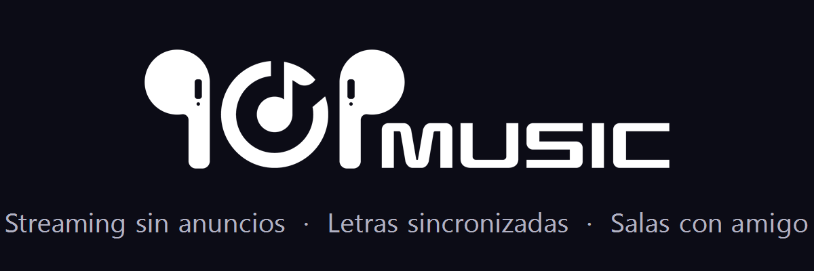
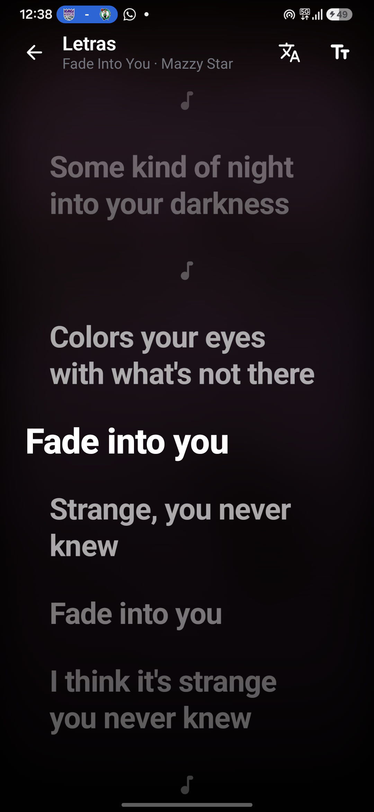
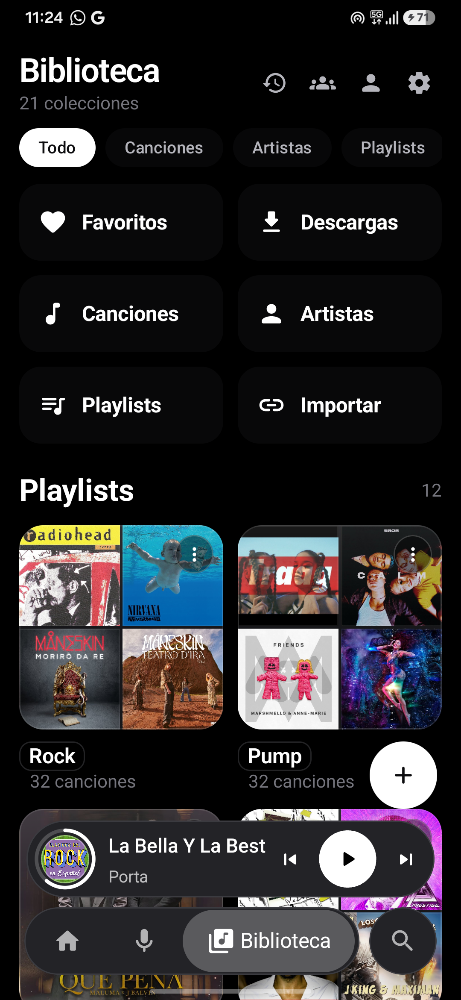
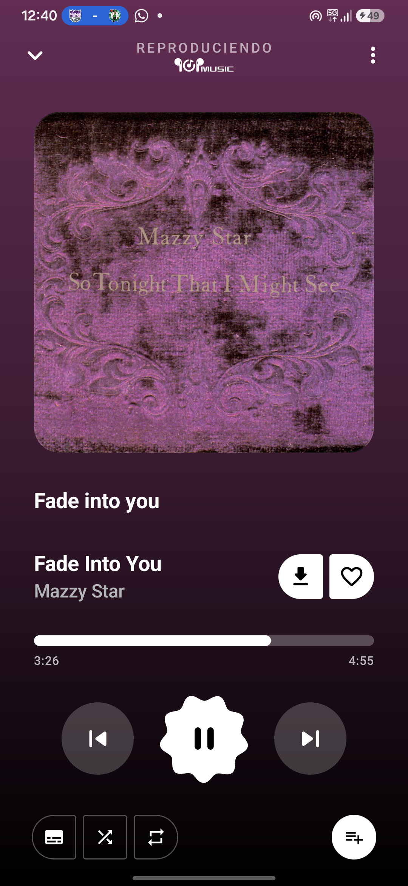
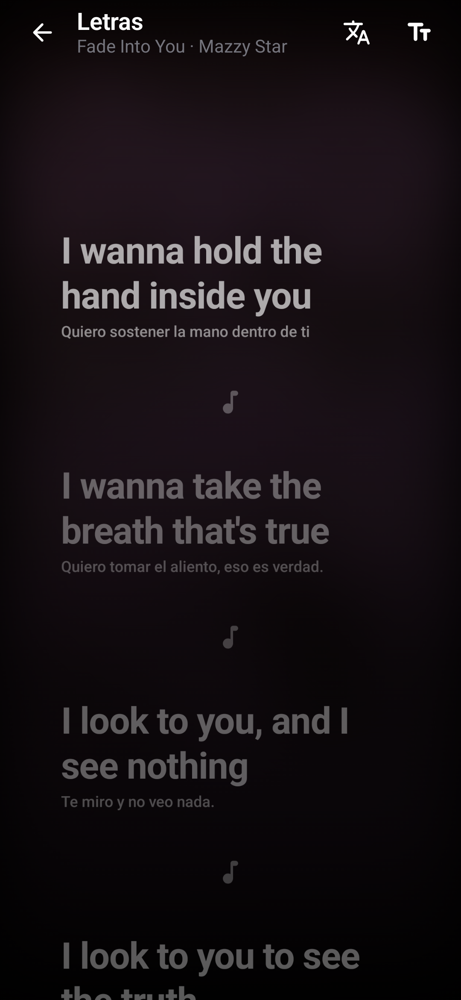

<div align="center">
  

  <p><b>App de música para Android: streaming sin anuncios, letras sincronizadas, descargas offline y salas para escuchar con amigos en tiempo real.</b></p>

  <p>
    <a href="https://4lexzx.github.io/PoPMusic/">🌐 Sitio web</a> ·
    <a href="https://4lexzx.github.io/PoPMusic/privacidad.html">🔒 Privacidad</a> ·
    <a href="https://4lexzx.github.io/PoPMusic/terminos.html">📄 Términos</a>
  </p>

  <p>
    
    
    
    
  </p>
</div>

---

## 📸 Capturas

<div align="center">
  <table>
    <tr>
      <td align="center" style="padding: 12px;">
        <b>Inicio</b><br><br>
        
      </td>
      <td align="center" style="padding: 12px;">
        <b>Buscar</b><br><br>
        
      </td>
      <td align="center" style="padding: 12px;">
        <b>Biblioteca</b><br><br>
        
      </td>
    </tr>
    <tr>
      <td align="center" style="padding: 12px;">
        <b>Reproductor</b><br><br>
        
      </td>
      <td align="center" style="padding: 12px;">
        <b>Letras sincronizadas</b><br><br>
        
      </td>
      <td align="center" style="padding: 12px;">
        <b>Salas con amigos</b><br><br>
        
      </td>
    </tr>
  </table>
</div>

---

## ✨ Características

<details>
<summary><b>🎙 Reproducción</b></summary>
<br>

- **Streaming sin anuncios** de YouTube con el extractor de NewPipe y Media3/ExoPlayer.
- **Cola completa**: siguiente/anterior, aleatorio, repetir (todo/una), salto a cualquier pista.
- **Transiciones**: crossfade de hasta 10 s, fundido de entrada y salto automático de silencios.
- **Reproducción instantánea**: precarga de la cola para que el aleatorio sea inmediato.
- **Segundo plano y pantalla bloqueada** con controles de Media Session (notificación con shuffle/repeat).
- **Descargas offline**: descarga canciones y reprodúcelas sin datos (funciona en modo avión).
- **Temporizador de sueño**, ecualizador de 5 bandas y refuerzo de volumen.

</details>

<details>
<summary><b>📝 Letras sincronizadas</b></summary>
<br>

- **Letras en tiempo real** desde LRCLIB con la línea activa resaltada al estilo Echo.
- **Estilos de letra**: clásico, grande, serif y monoespaciado.
- **Letras inline**: arrastra hacia abajo sobre la carátula para ver la letra mientras suena.
- **Información de la canción**: foto y biografía del artista (Wikipedia), álbum y ficha técnica.
- **Music DNA**: el backstory de la canción basado en Wikipedia.

</details>

<details>
<summary><b>🔍 Búsqueda y descubrimiento</b></summary>
<br>

- **Búsqueda** de canciones, videos y artistas en YouTube con filtros (ocultar videos y Shorts).
- **Tendencias mundiales y de tu país** desde Spotify Charts, resueltas a YouTube.
- **Reconocer música**: identifica la canción que suena a tu alrededor.
- **Chips de ánimo** y secciones de descubrimiento que se adaptan a lo que exploras.
- **Podcasts**: pestaña con novedades y suscripciones (iTunes + RSS), con reproducción directa.

</details>

<details>
<summary><b>📚 Biblioteca y playlists</b></summary>
<br>

- **Favoritos, recientes y descargas** guardados localmente en tu dispositivo.
- **Playlists** propias con portada en mosaico, añadir y quitar canciones.
- **Importar por enlace** playlists de YouTube y Spotify (se resuelven a YouTube).
- **Sincronización con YouTube**: crea tus playlists en tu cuenta y sube/borra canciones en tiempo real.
- **Exportar biblioteca** a JSON como copia de seguridad.

</details>

<details>
<summary><b>🎉 Salas “Todos controlan”</b></summary>
<br>

- **Crea una sala** y comparte el código: cualquiera puede entrar desde su móvil.
- **Cola compartida en vivo**: todos ven la misma cola; cualquier participante puede pausar, saltar o añadir canciones.
- **Sin host**: el último cambio manda; la sala sigue viva aunque navegues por la app.
- **Sugerencias por gustos** para llenar la sala rápido.

</details>

<details>
<summary><b>🎨 Personalización</b></summary>
<br>

- **Fondos dinámicos**: degradados o tu propia imagen, con desenfoque y oscurecimiento ajustables.
- **Cristal líquido** (liquid glass) en la barra de navegación, con transparencia ajustable.
- **Vista previa en vivo**: una miniatura de la pantalla de Inicio cambia en tiempo real con cada ajuste.
- **Reproductor minimalista**: ocultar carátula, canvas ambiental y arrastrar para cerrar.
- **Modo oscuro** de fúbrica con paleta negro, blanco y gris.

</details>

<details>
<summary><b>👤 Cuenta y extras</b></summary>
<br>

- **Inicio de sesión con Google** (Supabase) con avatar y estadísticas de escucha.
- **Establecer como tono** cualquier canción con un toque.
- **Compartir** canciones y abrir en YouTube.
- **Ajustes de contenido**: ocultar videos, Shorts y podcasts que no te interesen.

</details>

---

## 🧱 Stack técnico

| Área | Tecnología |
| --- | --- |
| Lenguaje | Kotlin |
| UI | Jetpack Compose + Material 3 |
| Audio | Media3 / ExoPlayer + extractor de NewPipe |
| Imágenes | Coil 3 |
| Letras | LRCLIB (`lrclib.net`) |
| Tendencias | Spotify Charts (embed público) → YouTube |
| Podcasts | iTunes Search API + RSS |
| Tiempo real | Supabase Realtime (WebSockets, para las Salas) |
| Cuenta | Supabase Auth (Google Sign-In) |
| Mínimo | Android 15 (API 35) |

---

## 🚀 Descargar e instalar

**[⬇️ Descargar APK (v0.1.0)](https://github.com/4lexzx/PoPMusic/releases/latest)** — Android 15 o superior.

1. Descarga el APK en tu móvil y ábrelo (acepta instalar de orígenes desconocidos si te lo pide).
2. Abre **PoP Music** y listo: tu biblioteca y tu sesión se guardan localmente.

<details>
<summary><b>Compilar desde el código</b></summary>
<br>

```bash
git clone https://github.com/4lexzx/PoPMusic.git
cd PoPMusic/native
```

1. Crea `native/local.properties` con la ruta de tu SDK:

   ```properties
   sdk.dir=C\:\\Users\\tu_usuario\\AppData\\Local\\Android\\Sdk
   ```

2. Compila la versión de producción:

   ```bash
   ./gradlew :app:assembleRelease
   ```

3. Instala el APK:

   ```bash
   adb install -r app/build/outputs/apk/release/app-release.apk
   ```

> En Windows usa `gradlew.bat`. El APK queda firmado con la clave del proyecto; para usar la tuya propia configura un `keystore.properties`.

</details>

---

## 🔒 Privacidad

- **Sin publicidad, sin rastreo de terceros y sin venta de datos.**
- Tu biblioteca, favoritos y playlists se guardan **localmente** en tu dispositivo.
- Solo se sincroniza lo que tú decidas al vincular una cuenta (playlists e IDs de vídeos para la sincronización).
- Política completa: **[privacidad.html](https://4lexzx.github.io/PoPMusic/privacidad.html)** · Términos: **[terminos.html](https://4lexzx.github.io/PoPMusic/terminos.html)**

**Contacto:** [solisumboalexander@hotmail.com](mailto:solisumboalexander@hotmail.com)

---

## ⚠️ Aviso legal

PoP Music es una app libre y gratuita creada con fines educativos y de uso personal. No almacena, sube ni distribuye contenido con derechos: la reproducción se realiza sobre enlaces públicos de YouTube respetando sus Términos de Servicio. Si eres titular de un contenido y tienes alguna consulta legal, escríbenos a [solisumboalexander@hotmail.com](mailto:solisumboalexander@hotmail.com).

Apoya a los artistas: considera una suscripción a [YouTube Premium](https://www.youtube.com/premium).
