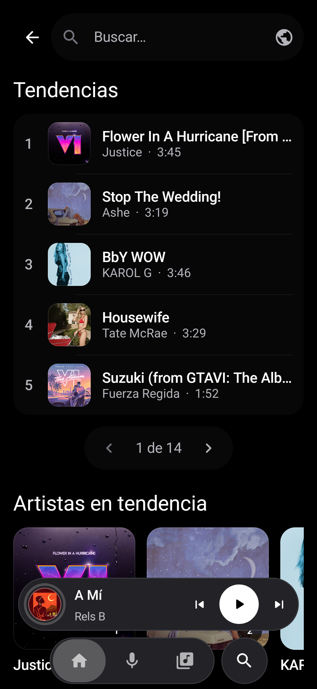
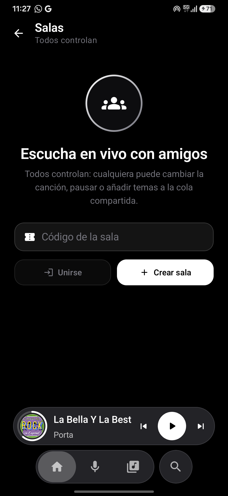

<div align="center">
  

  <p><b>Aplicación de música para Android</b></p>

  <p>Streaming sin anuncios, letras sincronizadas, descargas offline y salas para escuchar en tiempo real con amigos.</p>

  <p>
    <a href="https://4lexzx.github.io/PoPMusic/">Sitio web</a> ·
    <a href="https://4lexzx.github.io/PoPMusic/privacidad.html">Política de privacidad</a> ·
    <a href="https://4lexzx.github.io/PoPMusic/terminos.html">Términos de servicio</a> ·
    <a href="https://github.com/4lexzx/PoPMusic/releases/latest">Descargar APK</a>
  </p>

  <p>
    
    
    
    
  </p>
</div>

---

## Descarga

**[PoP Music v0.1.0](https://github.com/4lexzx/PoPMusic/releases/latest)** — requiere Android 8.0 (API 26) o superior.

Descarga el APK en el dispositivo y ábrelo para instalarlo. La biblioteca, las playlists y la sesión se guardan localmente; nada se pierde al reinstalar.

---

## Capturas

<div align="center">
  <table>
    <tr>
      <td align="center" style="padding: 12px;">
        <b>Inicio</b><br><br>
        
      </td>
      <td align="center" style="padding: 12px;">
        <b>Búsqueda</b><br><br>
        
      </td>
      <td align="center" style="padding: 12px;">
        <b>Biblioteca</b><br><br>
        
      </td>
    </tr>
    <tr>
      <td align="center" style="padding: 12px;">
        <b>Reproductor</b><br><br>
        
      </td>
      <td align="center" style="padding: 12px;">
        <b>Letras sincronizadas</b><br><br>
        
      </td>
      <td align="center" style="padding: 12px;">
        <b>Salas compartidas</b><br><br>
        
      </td>
    </tr>
  </table>
</div>

---

## Características

### Reproducción

- Reproducción sin anuncios a partir de contenido público de YouTube (extractor de NewPipe + Media3/ExoPlayer).
- Cola completa con siguiente, anterior, modo aleatorio, repetir y salto directo a cualquier pista.
- Crossfade configurable, fundido de entrada y salto automático de silencios.
- Precarga de la cola para que el cambio de pista sea inmediato.
- Reproducción en segundo plano y con la pantalla bloqueada, con controles desde la notificación.
- Descargas offline reproducibles en modo avión.
- Temporizador de sueño, ecualizador de 5 bandas y refuerzo de volumen.

### Letras

- Letras sincronizadas en tiempo real (LRCLIB) con la línea activa resaltada.
- Cuatro estilos de letra: clásico, grande, serif y monoespaciado.
- Letras en línea sobre la carátula del reproductor.
- Información de la canción: biografía del artista, álbum y ficha técnica.
- Music DNA: contexto de la canción basado en Wikipedia.

### Búsqueda y descubrimiento

- Búsqueda de canciones, videos y artistas en YouTube, con filtros para ocultar videos y Shorts.
- Tendencias mundiales y por país desde Spotify Charts, resueltas a YouTube.
- Reconocimiento de música en directo.
- Chips de estado de ánimo y secciones de recomendación que se adaptan al uso.
- Pestaña de podcasts con novedades, suscripciones y reproducción directa (iTunes + RSS).

### Biblioteca y playlists

- Favoritos, recientes y descargas guardados localmente.
- Playlists propias con portada en mosaico.
- Importación por enlace de playlists de YouTube y Spotify.
- Sincronización con la cuenta de YouTube: creación de playlists y alta/baja de canciones en tiempo real.
- Exportación de la biblioteca a JSON como copia de seguridad.

### Salas "Todos controlan"

- Creación de sala con código compartible; cualquiera entra desde su dispositivo.
- Cola compartida en vivo: cualquier participante puede pausar, saltar o añadir canciones.
- Sin anfitrión fijo: el último cambio es el que prevalece.
- Sugerencias de canciones según los gustos de cada usuario.

### Personalización

- Fondos dinámicos: degradados o imagen propia, con desenfoque y oscurecimiento ajustables.
- Cristal líquido opcional en la barra de navegación.
- Vista previa en vivo de la pantalla de inicio que refleja cada ajuste en tiempo real.
- Reproductor minimalista con carátula oculta, canvas ambiental y gesto de arrastre para cerrar.

### Cuenta y extras

- Inicio de sesión con Google y avatar en la pantalla de cuenta.
- Establecer cualquier canción como tono de llamada.
- Compartir canciones y abrirlas directamente en YouTube.

---

## Stack técnico

| Área | Tecnología |
| --- | --- |
| Lenguaje | Kotlin |
| Interfaz | Jetpack Compose + Material 3 |
| Audio | Media3 / ExoPlayer + extractor de NewPipe |
| Imágenes | Coil 3 |
| Letras | LRCLIB |
| Tendencias | Spotify Charts (embed público) → YouTube |
| Podcasts | iTunes Search API + RSS |
| Tiempo real | Supabase Realtime (WebSockets) |
| Cuenta | Supabase Auth (Google Sign-In) |
| Mínimo | Android 8.0 (API 26) |

---

## Compilación

```bash
git clone https://github.com/4lexzx/PoPMusic.git
cd PoPMusic/native
```

1. Crear `native/local.properties` con la ruta del SDK de Android:

   ```properties
   sdk.dir=C\:\\Users\\tu_usuario\\AppData\\Local\\Android\\Sdk
   ```

2. Compilar la versión de producción (en Windows, `gradlew.bat`):

   ```bash
   ./gradlew :app:assembleRelease
   ```

3. Instalar el APK:

   ```bash
   adb install -r app/build/outputs/apk/release/app-release.apk
   ```

El APK de esta versión está firmado con la clave del proyecto. Para usar una propia, configurar un `keystore.properties` en `native/`.

---

## Privacidad

- Sin publicidad, sin rastreo de terceros y sin venta de datos.
- La biblioteca, los favoritos y las playlists se guardan localmente en el dispositivo.
- Al iniciar sesión, los me gusta y la biblioteca se guardan en tu cuenta y se sincronizan entre dispositivos; también se recuerdan las cuentas vinculadas.
- Solo se sincroniza lo que el usuario decide al vincular una cuenta.

Política completa: [privacidad.html](https://4lexzx.github.io/PoPMusic/privacidad.html) · Términos: [terminos.html](https://4lexzx.github.io/PoPMusic/terminos.html)

Contacto: [solisumboalexander@hotmail.com](mailto:solisumboalexander@hotmail.com)

---

## Aviso legal

PoP Music es una aplicación libre y gratuita, creada con fines educativos y de uso personal. No almacena, sube ni distribuye contenido con derechos: la reproducción se realiza sobre enlaces públicos de YouTube respetando sus Términos de Servicio. Para cualquier consulta de propiedad intelectual, escribir a [solisumboalexander@hotmail.com](mailto:solisumboalexander@hotmail.com).

Para apoyar a los artistas, considerar una suscripción a [YouTube Premium](https://www.youtube.com/premium).
